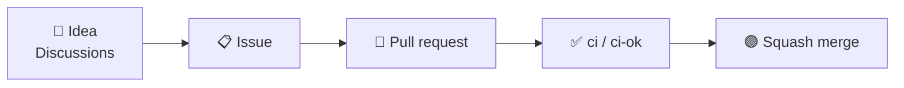

# Contributing

| Change | How |
| --- | --- |
| An idea | Start in [Discussions](https://github.com/SoulCraft-Org/sage/discussions/categories/ideas). An accepted idea becomes an issue |
| The plan | Edit [`docs/PLAN.md`](docs/PLAN.md) or the README in a pull request. Name the source and date of every figure |
| Every commit | Sign off with `git commit -s` ([DCO](https://developercertificate.org/)) |
| Every pull request | `ci / ci-ok` must pass: the voice lint over every Markdown file |

## 🤝 Ways to help

Each form is a short issue. A maintainer reviews it and turns it into a file. Every form asks you to offer your work under Apache-2.0.

| You have | Open the form |
| --- | --- |
| A test of how Sage should act | [Test scenario](https://github.com/SoulCraft-Org/sage/issues/new?template=scenario.yml) |
| A way a person can grow | [Practice](https://github.com/SoulCraft-Org/sage/issues/new?template=practice.yml) |
| A study, report or law | [Research source](https://github.com/SoulCraft-Org/sage/issues/new?template=source.yml) |
