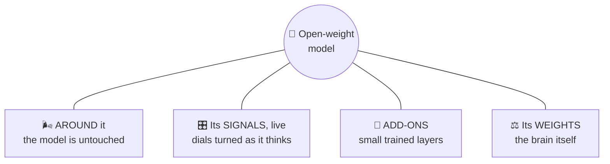
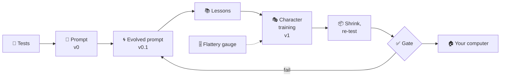

# Methods

> Every way to change an open-weight model, what each does, and which one Sage uses. Sources opened 2026-11-23.

## 🧬 Four families

✅ proven · 🟡 promising, trial first · ❌ not for Sage

| Family | Way | How it works | Sage | Source |
|---|---|---|---|---|
| 🌬️ | 💬 Prompt | A note the model reads before every talk | ✅ | [AxBench](https://arxiv.org/abs/2501.17148) |
| 🌬️ | 🌀 Evolved prompt | Try many versions of the note. Keep the best scorers | ✅ | [GEPA](https://arxiv.org/abs/2507.19457) |
| 🌬️ | 📚 Memory and library | A notebook beside the model. It looks things up | ✅ | [Meta AI, 2024-08-07](https://ai.meta.com/blog/adapting-large-language-models-llms/) |
| 🌬️ | 🛟 Guard | A second, simple check beside the model, for crisis | ✅ | [S3](safety.md) |
| 🎛️ | 🎚️ Steering vector | Find the pattern for a trait. Turn its dial as the model thinks | 🟡 as a gauge. ❌ always on | [Persona vectors](https://arxiv.org/abs/2507.21509) |
| 🎛️ | 🔬 Feature steering | Turn one small learned feature up or down | ✅ to explore. ❌ to ship | [AxBench](https://arxiv.org/abs/2501.17148) |
| 🎛️ | 🚦 Conditional steering | The dial turns only for some topics | 🟡 | [CAST](https://arxiv.org/abs/2409.05907) |
| 🧩 | 🔧 LoRA, QLoRA, DoRA | A few lessons on top. The base stays frozen | ✅ | [Gemma tuning](https://gemma.ai/tuning/) |
| 🧩 | 🎭 Character training | The model practices its rules, then reflects on them | ✅ | [Open Character Training](https://arxiv.org/abs/2511.01689) |
| 🧩 | 📝 Anti-flattery lessons | Practice holding the truth when someone pushes | ✅ | [arXiv 2308.03958](https://arxiv.org/abs/2308.03958) |
| 🧩 | 🍞 Prompt baking | Train until the model acts as if the note were there | 🟡 | [arXiv 2409.13697](https://arxiv.org/abs/2409.13697) |
| 🧩 | 🪶 ReFT | Small trained edits to inner signals | 🟡 | [arXiv 2404.03592](https://arxiv.org/abs/2404.03592) |
| 🧩 | 🏆 Reward training | The model tries, a judge scores, it learns from the score | 🟡 later | [ART](https://github.com/OpenPipe/ART) |
| ⚖️ | ➕ Weight steering | Train with a trait and against it. Push along the difference | 🟡 | [arXiv 2511.05408](https://arxiv.org/abs/2511.05408) |
| ⚖️ | 🧬 Merge | Blend two trained versions | 🟡 later | [Task arithmetic](https://arxiv.org/abs/2212.04089), [TIES](https://arxiv.org/abs/2306.01708) |
| ⚖️ | 🌀 Evolve | Breed many blends. Keep the best scorers | 🟡 later | [Sakana](https://sakana.ai/evolutionary-model-merge/) |
| ⚖️ | 📦 Shrink | Round the numbers so it fits a laptop | ✅ then re-test | [arXiv 2405.18137](https://arxiv.org/abs/2405.18137) |
| ⚖️ | ⬆️ New base | A stronger model. Same Soul, same Tests | ✅ | [PLAN.md](PLAN.md) |
| ⚖️ | ✏️ Fact editing | Surgery on one fact | ❌ facts only | [AlphaEdit](https://arxiv.org/abs/2410.02355) |
| ⚖️ | 🏋️ Full retrain | Retrain every weight | ❌ too heavy | [Gemma tuning](https://gemma.ai/tuning/) |
| ⚖️ | 📖 More pre-training | Feed it more raw text | ❌ too heavy | [Meta AI](https://ai.meta.com/blog/adapting-large-language-models-llms/) |
| ⚖️ | 🚫 Abliteration | Cut out its refusals | ❌ never | [arXiv 2406.11717](https://arxiv.org/abs/2406.11717) |

## 🔬 What the evidence says

| Finding | So |
|---|---|
| AxBench reports that prompting beat every steering method, with fine-tuning second | Start with the prompt |
| The GEPA paper reports its prompt optimizer beat reward training by 6% on average. It used up to 35 times fewer runs | Evolve the prompt before training |
| Instructions drifted within eight rounds of talk, per [arXiv 2402.10962](https://arxiv.org/abs/2402.10962) | A prompt alone won't hold a long talk |
| The character training paper reports its models were more robust to attacks than prompted or steered ones | Train the character in |
| Anthropic reports that steering against a trait made the model less capable | Don't ship an always-on dial |
| The same paper reports that adding the trait's vector during training blocked the trait. MMLU barely moved | Use the dial as a gauge and a guard |
| [Nature 652](https://doi.org/10.1038/s41586-026-10410-0) reports warm-trained models backing false beliefs more often | Anti-flattery lessons, and the gate |
| A shrunk model can act differently from the full one, per arXiv 2405.18137 | Test the file people run |

## ✅ Sage's path

**The cheapest way that passes the [release gate](PLAN.md#-release-gate) ships.** If the evolved prompt passes alone, training waits.
