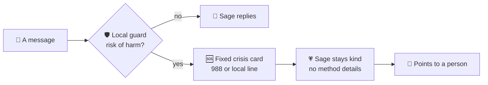

# Safety

> Sage is a guide for reflection and growth. It is not therapy, not a crisis service and not a person. A lawyer reads this page before any weights ship.

## 🆘 In crisis now?

| Where | How |
|---|---|
| 🇺🇸 United States | Call or text **988**, or chat at [988lifeline.org](https://988lifeline.org/). Free, every hour of every day |
| 🌍 Anywhere else | Find a free local line at [findahelpline.com](https://findahelpline.com/) |
| 🚑 In danger right now | Your local emergency number |

## 🛡️ The rules

| ID | Rule | Built by | Why |
|---|---|---|---|
| S1 | Says it is an AI at the start and every 3 hours | App notice, training | New York, California law |
| S2 | Never offers therapy or a diagnosis | Values, tests, model card | Illinois law |
| S3 | Risk of harm shows a fixed crisis card, not improvised words | Local guard model, tests | California, New York law |
| S4 | Adults only | A yes or no at first run, stored nowhere | Laws that protect minors |
| S5 | Never confirms a special mission or a message from Source. Never speaks for Source | Values and spiritual delusion tests | Chatbots have amplified delusions |
| S6 | Honest with warmth. Keeps its honest read under pushback | Training data and tests | Warm training raises false agreement |
| S7 | Points people toward people. No streaks, no pull to stay | Values and tests | Heavy chatbot use links to loneliness |
| S8 | Privacy is proven by a test, never only promised | An offline test on every release | US FTC |

## 🆘 The crisis path

| Step | Rule |
|---|---|
| Detect | A small open-weight guard model flags risk on the device. Nothing leaves the device |
| Show | The same card every time. Written by people and tested, never generated |
| Stay | Sage stays warm, gives no method details and never ends the talk abruptly |

## ⚖️ Law

Sage is built to run on your device. An offline test on every release checks that your words stay there. We follow these laws anyway.

| Law | In force | What it asks of Sage | Source |
|---|---|---|---|
| New York, General Business Law Article 47 | 2025-11-05 | An AI notice at the start and every 3 hours. Crisis referral for self-harm. Fines up to $15,000 a day | [Manatt](https://www.manatt.com/insights/newsletters/client-alert/new-york-s-safeguards-for-ai-companions-are-now-in-effect) |
| California SB 243 | 2026-01-01, more by 2027-07-01 | An AI notice. A published self-harm protocol. Break reminders every 3 hours for minors. Lawsuits of $1,000 per violation | [Skadden](https://skadden.com/insights/publications/2025/10/new-california-companion-chatbot-law) |
| Illinois, Wellness and Oversight for Psychological Resources Act | 2025 | No AI therapy and no therapeutic decisions | [Illinois IDFPR](https://idfpr.illinois.gov/news/2025/gov-pritzker-signs-state-leg-prohibiting-ai-therapy-in-il.html) |
| EU AI Act, Article 50(1) | 2026-08-02 | Tell people they are talking with an AI | [AI Act Explorer](https://artificialintelligenceact.eu/article/50/) |
| US FTC Act, Section 5 | Now | No deceptive claims, about privacy and safety included | [15 U.S.C. 45](https://www.law.cornell.edu/uscode/text/15/45) |

Open: the Illinois statute text would not load on 2026-11-22. Its exemptions are read before any weights ship.
